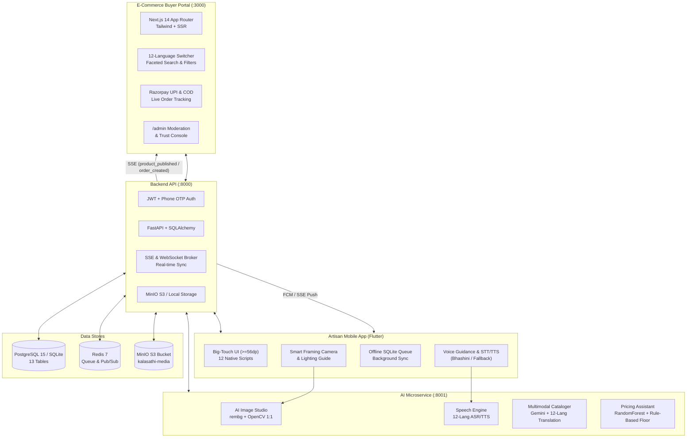
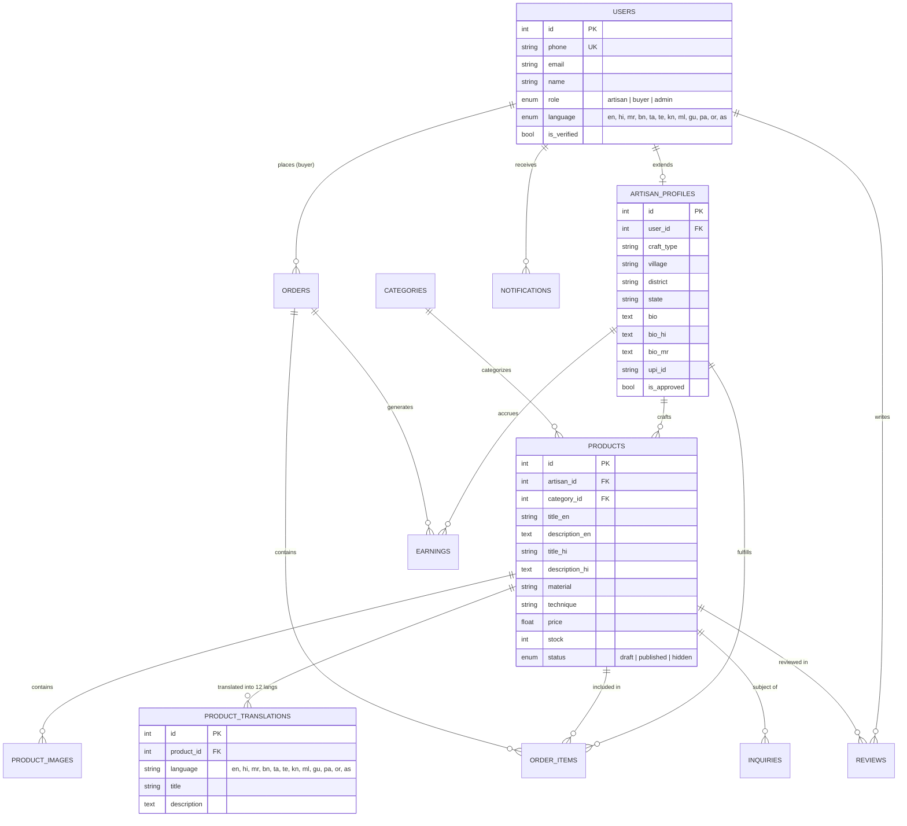

# KalaSathi System Architecture & Technical Specifications

**KalaSathi** is an AI-powered e-commerce ecosystem empowering marginalized rural Indian craftspeople to digitize handmade goods using **only photo + voice in 12 native Indian languages**, and connect directly with conscious global consumers.

---

## 1. High-Level System Architecture

---

## 2. End-to-End Data & Event Flows

### A. Core Add-Product Flow (Artisan Mobile to Web in < 2 mins)
1. **Onboarding & Language Selection**:
   - Artisan selects their native language from 12 native script cards (e.g. Marathi: *"मराठी"*).
   - Audio greeting plays: *"कलासाथी मध्ये आपले स्वागत आहे!"*.
   - Phone OTP verification logs the artisan in without passwords.
2. **Smart Framing Camera**:
   - Mobile camera uses bounding guide with voice feedback (*"Move closer"*, *"Center the craft"*).
   - Artisan snaps 1-4 high-resolution photos.
3. **AI Image Studio**:
   - Photo is uploaded to `POST /ai/enhance-image`.
   - Microservice runs OpenCV CLAHE lighting correction, white balance, and `rembg`/GrabCut background removal.
   - Artisan inspects before/after on an interactive dual-slider.
4. **Voice Cataloging**:
   - Artisan speaks in Marathi: *"मी हे वारली पेंटिंग तांदळाच्या पिठाने आणि डिंकाने बांबूच्या काडीने हाताने रंगवले आहे..."*
   - Sent to `POST /ai/catalog` with the enhanced image.
   - Transcribed via Bhashini ASR, structured via Gemini prompt into Craft Attributes (materials, technique, care).
   - Translated into all 12 Indian languages for database storage.
   - Read aloud to artisan via TTS for confirmation.
5. **Fair Pricing Assistant**:
   - Calculated via ML model trained on 40 craft archetypes:
     $$\text{Cost Floor} = \text{Material Cost} + (\text{Labor Hours} \times ₹85/\text{hr fair wage})$$
   - Displays Cost Floor (₹1,400), Suggested Market (₹1,800), and Premium Tier (₹2,200).
   - Artisan confirms with 1 tap.
6. **Instant Publication**:
   - Mobile sends payload to `POST /products`.
   - Backend persists product, images, and translations.
   - SSE Event Broker broadcasts `product_published` event.
   - Next.js website instantly renders the live banner and product in `/products`!

---

### B. Buyer Order to Artisan Notification Flow
1. **Browse & 12-Language Product View**:
   - Buyer visits `http://localhost:3000/products/1`.
   - Uses the **12-Language Switcher** pill to read description in English, Hindi, or Marathi.
2. **Checkout**:
   - Buyer adds item to cart and checks out via Razorpay (simulated test mode) or Cash on Delivery.
3. **Real-time Order Event**:
   - Backend `POST /orders` creates order and commits to database.
   - Dispatches `order_created` event through SSE broker and FCM.
   - The artisan's mobile app immediately displays incoming order dialog with audio ping: *"नवीन ऑर्डर मिळाली! ₹1,800"*.
4. **Fulfillment Stepper**:
   - Artisan marks order: **Accepted $\rightarrow$ Packed $\rightarrow$ Shipped**.
   - Buyer's tracking page `/orders/[id]` updates live.

---

## 3. Database Entity Relationship (ER) Model

---

## 4. 12 Mandatory Indian Languages

| Code | Language | Native Script | Primary ASR / TTS Provider | Translation Engine |
| :--- | :--- | :--- | :--- | :--- |
| `en` | English | English | ULCA / Google Speech | Gemini 1.5 Pro |
| `hi` | Hindi | हिन्दी | Bhashini ULCA | Gemini 1.5 Pro |
| `mr` | Marathi | मराठी | Bhashini ULCA | Gemini 1.5 Pro |
| `bn` | Bengali | বাংলা | Bhashini ULCA | Gemini 1.5 Pro |
| `ta` | Tamil | தமிழ் | Bhashini ULCA | Gemini 1.5 Pro |
| `te` | Telugu | తెలుగు | Bhashini ULCA | Gemini 1.5 Pro |
| `kn` | Kannada | ಕನ್ನಡ | Bhashini ULCA | Gemini 1.5 Pro |
| `ml` | Malayalam | മലയാളം | Bhashini ULCA | Gemini 1.5 Pro |
| `gu` | Gujarati | ગુજરાતી | Bhashini ULCA | Gemini 1.5 Pro |
| `pa` | Punjabi | ਪੰਜਾਬੀ | Bhashini ULCA | Gemini 1.5 Pro |
| `or` | Odia | ଓଡ଼ିଆ | Bhashini ULCA | Gemini 1.5 Pro |
| `as` | Assamese | অসমীয়া | Bhashini ULCA | Gemini 1.5 Pro |

---

## 5. Security & Fallback Design

1. **Zero-API-Key Mock Mode**:
   - `AI_MOCK_MODE=True` guarantees all voice recognition, translation, background removal, and pricing functions work offline without external API keys.
2. **Cross-Database Portability**:
   - Supports async PostgreSQL in Docker and automatic graceful fallback to SQLite (`kalasathi.db`) on developer environments.
3. **Strict Fair Wage Floor**:
   - Pricing algorithm enforces $\text{Price} \ge \text{Material Cost} + (\text{Labor Hours} \times ₹85/\text{hr})$. Artisans can never be undercut below a livable wage.
