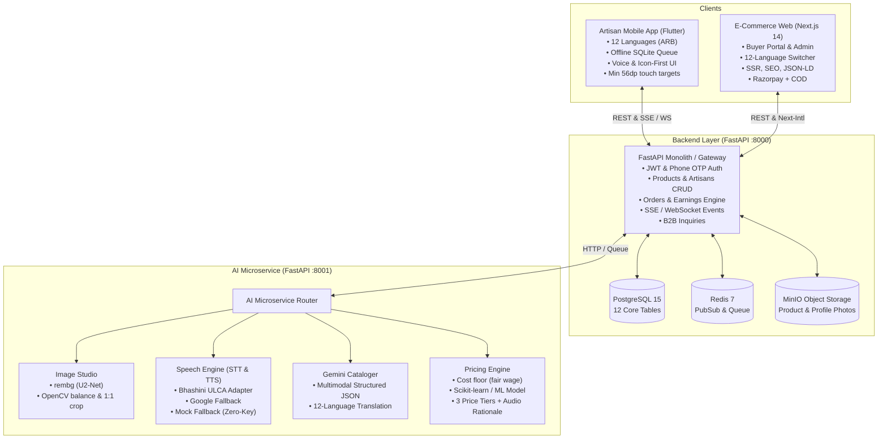

# KalaSathi: Implementation Plan & Phase-by-Phase Roadmap

## 1. System Architecture Overview

---

## 2. Design System & Accessibility (Artisan-Centric)
- **Palette**: Earthy Indian Handicraft Theme
  - **Terracotta Primary**: `#C85A32` / `#B84A28` (Warm earth, pottery, trust)
  - **Deep Indigo Secondary**: `#2C3E6B` / `#1F2D4A` (Kalamkari, depth, professionalism)
  - **Turmeric Accent**: `#E09F3E` / `#D48B28` (Festive, high contrast highlights)
  - **Sand / Off-White Background**: `#FAF7F2` / `#F3EFE6` (Clean canvas, natural feel)
  - **Charcoal Text**: `#262220` (High contrast, readability for low-vision)
- **Ergonomics**:
  - Touch targets **≥ 56dp** on mobile.
  - **Icon-first and audio-first**: Every primary action accompanied by an audio prompt icon.
  - Persistent **"Help (Speak)"** floating button on every mobile screen.
  - **Noto Font Family** (`Noto Sans`, `Noto Serif Devanagari`, `Noto Sans Tamil`, etc.) ensuring flawless typography across all 12 Indian scripts.

---

## 3. Mandatory 12 Language Coverage Matrix

| Language | Code | Native Script Name | Flutter ARB | Web Next-Intl / Stored | Bhashini / Google STT & TTS |
| :--- | :--- | :--- | :--- | :--- | :--- |
| **English** | `en` | English | Yes | Native UI + Stored | Supported |
| **Hindi** | `hi` | हिन्दी | Yes | Native UI + Stored | Supported |
| **Marathi** | `mr` | मराठी | Yes | Native UI + Stored | Supported |
| **Bengali** | `bn` | বাংলা | Yes | Stored Catalog | Supported |
| **Tamil** | `ta` | தமிழ் | Yes | Stored Catalog | Supported |
| **Telugu** | `te` | తెలుగు | Yes | Stored Catalog | Supported |
| **Kannada** | `kn` | ಕನ್ನಡ | Yes | Stored Catalog | Supported |
| **Malayalam**| `ml` | മലയാളം | Yes | Stored Catalog | Supported |
| **Gujarati** | `gu` | ગુજરાતી | Yes | Stored Catalog | Supported |
| **Punjabi** | `pa` | ਪੰਜਾਬੀ | Yes | Stored Catalog | Supported |
| **Odia** | `or` | ଓଡ଼ିଆ | Yes | Stored Catalog | Supported |
| **Assamese** | `as` | অসমীয়া | Yes | Stored Catalog | Supported |

---

## 4. Phase-by-Phase Execution Plan

### Phase 1: Backend API & Data Infrastructure (`/services/api`)
1. **Database Models & Alembic Migrations**:
   - Complete models in `app/models/` (`users`, `artisan_profiles`, `products`, `product_images`, `product_translations`, `categories`, `orders`, `order_items`, `reviews`, `inquiries`, `notifications`, `earnings`, `otp_codes`).
   - Configure Alembic and generate initial migration scripts with proper indices and foreign keys.
2. **Pydantic Schemas (`app/schemas/`)**:
   - Comprehensive request/response validation schemas for Auth, Artisans, Products, Orders, Inquiries, Notifications, and Analytics.
3. **Core Services & Utils (`app/utils/` & `app/core/`)**:
   - MinIO / S3 client for image uploading with public URL generation.
   - Event broadcaster (SSE / WebSocket) for real-time notifications when a product is published or an order is placed.
   - OTP generation and verification service with mock bypass for seamless testing.
4. **API Routers (`app/api/v1/`)**:
   - `/auth`: Phone OTP request, OTP verify, Buyer email/password/OTP login, JWT me endpoint.
   - `/artisans`: Profile retrieval, onboarding update, bank/UPI update, public artisan directory.
   - `/products`: Full CRUD, draft-to-published state machine, filters by category, state, price, and artisan.
   - `/orders`: Order creation (COD / Razorpay test), status transition (`pending` -> `accepted` -> `packed` -> `shipped` -> `delivered`), artisan order history with buyer addresses.
   - `/inquiries`: B2B wholesale inquiry submission, artisan inbox retrieval, status updates.
   - `/earnings`: Artisan balance calculation, settled vs. pending earnings, monthly earnings aggregate.
   - `/notifications`: In-app notification retrieval, mark-as-read.
   - `/admin`: Artisan approval/rejection, product moderation, platform statistics.
   - `/events`: Server-Sent Events (SSE) / WebSocket endpoint for instant live updates.
5. **Testing & Verification**:
   - Pytest suite testing auth flow, product publishing, order placement, and status updates.

---

### Phase 2: AI Microservice (`/services/ai`)
1. **Service Foundation (`services/ai/app/`)**:
   - FastAPI microservice on port 8001 with modular routers, CORS, and health checks.
2. **AI Image Studio (`services/ai/app/image/`)**:
   - Integration with `rembg` (U2-Net) for automatic artisan photo background removal.
   - OpenCV pipeline for auto-contrast, white-balance correction, and smart 1:1 square & 4:5 portrait cropping.
   - Fallback simulation pipeline if heavy ONNX models are disabled in mock mode.
3. **Speech-to-Text & Text-to-Speech (`services/ai/app/speech/`)**:
   - Bhashini ULCA API adapter for Indian languages.
   - Google Speech-to-Text & Text-to-Speech fallback adapter.
   - High-fidelity mock adapter returning transcribed artisan voice and synthetic speech payloads with zero external API dependencies.
4. **Multimodal Cataloging & 12-Language Translation (`services/ai/app/catalog/`)**:
   - Gemini API integration with structured JSON schema prompting taking transcript + product photo.
   - Extracts: product title, materials, traditional technique, care instructions, category slug, SEO keywords.
   - Automated batch translation pipeline producing titles and descriptions in all 12 languages.
5. **Smart Pricing Assistant (`services/ai/app/pricing/`)**:
   - Synthetic dataset generation (`services/ai/data/artisan_pricing_dataset.csv`) based on craft category, material costs, labor hours, and historical market prices across India.
   - Scikit-learn pricing model trained on the dataset + rule-based cost floor calculator:
     $$\text{Cost Floor} = \text{Material Cost} + (\text{Labor Hours} \times \text{Fair Hourly Wage})$$
   - Computes three tiers:
     - **Cost Floor**: Absolute minimum ensuring artisan never sells at a loss.
     - **Suggested Fair Market Price**: Balanced price ensuring healthy margin and market competitiveness.
     - **Premium Artisan Price**: High-end boutique pricing for export/luxury market.
   - Returns audio-friendly explanation strings in the artisan's selected language.
6. **Testing & Verification**:
   - Pytest suite validating image enhancement, voice transcription/synthesis mocks, catalog generation, and price calculations.

---

### Phase 3: Artisan Mobile App (`/apps/mobile`)
1. **Flutter Setup & Internationalization**:
   - Flutter cross-platform architecture with standard clean MVVM / Provider state management.
   - 12 Flutter ARB localization files with native script support and Noto font typography.
2. **Design System & Reusable Widgets**:
   - Minimum 56dp touch targets, big icon buttons, high contrast terracotta/indigo theme.
   - Floating persistent `HelpVoiceButton` widget playing screen instructions via TTS.
   - Offline sync service using SQLite (`sqflite`) for storing offline product drafts and queueing uploads.
3. **Core App Screens**:
   - **Language Picker Screen**: 12 native language tiles with audio greeting ("Namaste! Please choose your language").
   - **Onboarding Flow**: Big number keypad for OTP login, voice-assisted profile creation (name, craft, village, state, photo).
   - **Artisan Dashboard**: High-contrast tiles: "Add Product" (prominent primary action), "My Products", "Orders", "Earnings", "Learn".
   - **Add Product Wizard (<2 Minutes)**:
     1. *Smart Camera*: framing overlay with audio feedback ("Hold steady", "Move closer").
     2. *AI Image Studio*: before/after interactive image slider showing background removal.
     3. *Voice Cataloging*: big record button, audio waveform, live transcription preview, TTS readback for confirmation.
     4. *Pricing Assistant*: 3 large interactive cards (Cost Floor, Fair Market, Premium) with spoken audio rationale.
     5. *Publish*: Single green tap publishing the product to the backend and triggering instant live web catalog update.
   - **My Products**: Voice-driven stock counter (+/- stock with voice confirmation), visibility toggle.
   - **Orders Screen**: Live incoming orders with audio chime, status tracker (Accept -> Pack -> Shipped), buyer address sheet.
   - **Earnings & Learn**: Simple visual income bar charts + short voice-guided micro-lessons (Photography tips, Fair pricing, Storytelling).
   - **Settings**: Bank/UPI details, language switcher, voice guidance speed.
4. **Verification & Testing**:
   - Flutter unit tests and widget smoke testing.

---

### Phase 4: Buyer E-Commerce Website (`/apps/web`)
1. **Next.js 14 App Router & Styling**:
   - Next.js 14, TypeScript, Tailwind CSS, Lucide icons, responsive mobile-first layout.
   - Consistent earthy handicraft palette matching the mobile app.
2. **Internationalization & SEO**:
   - `next-intl` localization for UI (en, hi, mr) + on-demand 12-language switcher for product content pulling from backend `product_translations`.
   - SSR product pages with metadata tags, OpenGraph images, and JSON-LD schema (`Product`, `Offer`, `Artisan`).
3. **Core Buyer Pages**:
   - **Home Page**: Hero banner with artisan spotlight, craft category carousel (Pottery, Handloom, Woodcraft, Jewelry, Painting), featured state crafts, trending items.
   - **Product Listing (`/products`)**: Filter sidebar (category, price range, state, technique), sort options (popular, price low-high), responsive grid.
   - **Product Details (`/products/[id]`)**: High-resolution gallery, 12-language description selector, "Made by [Artisan Name]" trust badge with village/state badge, craft heritage story, verified reviews, "Add to Cart" and "Buy Now".
   - **Artisan Profile Page (`/artisans/[id]`)**: Full artisan biography, craft journey, photo, map badge, and catalog of their unique handmade products.
   - **Cart & Checkout (`/cart`, `/checkout`)**: Cart drawer/page, shipping address form, Razorpay test payment modal + Cash on Delivery option.
   - **Order Tracking (`/orders/[id]`)**: Visual status stepper matching artisan app updates.
   - **B2B Bulk Inquiry**: Wholesale inquiry modal on product pages with automatic translation into the artisan's native language.
   - **Admin Moderation Portal (`/admin`)**: Artisan profile verification, product approvals, order tracking, and platform health stats.
4. **Verification & Testing**:
   - Web build validation, TypeScript type-check, and component rendering verification.

---

### Phase 5: End-to-End Integration, Realistic Seeding, & Polish
1. **Database Seeding (`services/api/app/seed.py`)**:
   - 3 rich artisan profiles with realistic stories and regional crafts:
     - *Rameshwar Chitrakar* (Madhubani painting, Madhubani, Bihar - Hindi/Maithili)
     - *Sunita Bai Sonawane* (Warli tribal art, Palghar, Maharashtra - Marathi)
     - *Basavaraju Gudigar* (Channapatna wooden lacquer toys, Ramanagara, Karnataka - Kannada)
   - 20 handcrafted products with high-quality craft imagery, complete 12-language translations, techniques, care instructions, and fair pricing.
   - 5 sample buyers with test orders in varying statuses (`pending`, `accepted`, `shipped`, `delivered`), reviews, and B2B inquiries.
2. **Real-time Live Sync Verification**:
   - Publish product in mobile app -> instantly reflects in Next.js web catalog via SSE/WebSocket.
   - Place order on website -> artisan app receives immediate notification and order item.
3. **Containerization & Orchestration (`docker-compose.yml`)**:
   - Ensure `docker compose up` cleanly orchestrates Postgres, Redis, MinIO, API, AI service, and Web frontend with zero missing dependencies.
4. **Documentation & Polish (`/docs`)**:
   - Comprehensive `README.md` with a quickstart guide under 10 steps.
   - Architecture diagrams, API Swagger documentation, and demo credentials.

---

## 5. Review & Approval Task List

| Phase | Description | Deliverables | Status |
| :---: | :--- | :--- | :---: |
| **0** | **Architecture & Plan Approval** | Detailed roadmap, task list, design system specs | **Awaiting Approval** |
| **1** | **Backend API & Database** | FastAPI schemas, routers, S3/MinIO, real-time events, tests | Planned |
| **2** | **AI Microservice** | rembg studio, Bhashini/Google/Mock STT/TTS, Gemini cataloger, Pricing ML model | Planned |
| **3** | **Artisan Mobile App** | Flutter 12-language ARB, offline SQLite, 5-step wizard, voice UI, tests | Planned |
| **4** | **E-Commerce Website** | Next.js 14, 12-language switcher, Razorpay/COD, B2B inquiries, Admin portal | Planned |
| **5** | **Integration & Seeding** | Seed script (3 artisans, 20 products, 5 buyers), end-to-end sync demo, docs | Planned |
